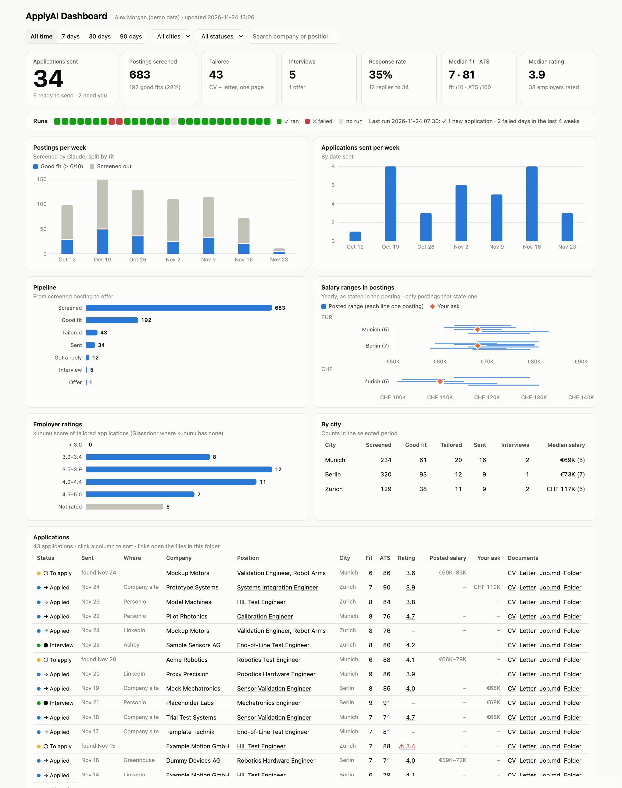

# ApplyAI

**A daily job search that writes your applications.** ApplyAI scans job boards every morning,
lets Claude screen each posting against your profile, and for every good fit writes a
**tailored one-page CV and cover letter** in your own design. It checks every claim against
your facts and scores the CV against applicant tracking systems (ATS). Then it helps you send
them, and you approve each one.

It runs as a [Claude Code](https://claude.com/claude-code) plugin on your own computer, with
your Claude subscription. No API key, no server, no account with us.

<picture>
  <source media="(prefers-color-scheme: dark)" srcset="docs/dashboard-dark.png">
  
</picture>

<sub>The dashboard every workspace gets (made-up demo data, see <a href="docs/demo_dashboard.py">docs/demo_dashboard.py</a>).</sub>

```
/applyai:setup   →   /applyai:run   →   /applyai:apply   →   /applyai:track
   your profile       new postings,        fills forms,        sent, interviews,
   and search         tailored CVs         you approve         offers
```

## Why it gets interviews

- **Tailored, not mass-produced.** Each CV is rewritten for one posting. It uses the posting's
  own wording where it's true, picks the most relevant entries, and leaves out the rest.
- **Only true facts.** Everything comes from one file you control (`facts.md`). A second model
  checks every claim against it, and anything unsupported is removed. Keywords that aren't
  true for you are listed as "skipped", never added.
- **Exactly one page, always full.** Each CV and letter is compiled, then shortened or refilled
  line by line until it fills one page in your layout. Bullets whose last line holds only one
  word are reworded.
- **ATS-checked.** The PDF text layer is scored locally the way Jobscan / Resume-Matcher do:
  keywords, must-haves, job title, sections, dates. Below target, one more pass works in the
  missing keywords that are true.
- **Your voice.** Cover letters follow the style of letters you wrote yourself.
- **Screened before you see it.** Claude scores every posting 0–10 against your profile and your
  own deal-breakers (visa, languages, seniority, ...). Only good fits get an application.
- **Context included.** Postings from YC / founder-network startups are tagged, and each
  employer gets its kununu / Glassdoor rating.

## Install

Requirements: Claude Code (Pro, Max, Team or Enterprise plan), Python 3.10+, a TeX
distribution and poppler. Node.js is only needed for the optional browser agent.

```bash
# macOS
brew install --cask mactex-no-gui && brew install poppler
# Ubuntu / Debian
sudo apt install texlive-latex-extra texlive-fonts-recommended poppler-utils
```

Then in Claude Code:

```
/plugin marketplace add beneaze/ApplyAI
/plugin install applyai@applyai
/applyai:setup
```

The setup takes 15–30 minutes. Claude:

1. checks your machine,
2. asks what you're looking for: roles, level, cities or remote, visa and languages,
   deal-breakers, dream companies,
3. reads your current CV (PDF, Word, LaTeX or a LinkedIn PDF),
4. *if you agree*, searches your **earlier Claude conversations** for projects and results
   that aren't on your CV. That's your local Claude Code history and memory, plus a claude.ai
   export if you give one. You confirm every fact before it's used,
5. writes your profile and search configuration, finds the job boards of the companies you
   care about,
6. runs a first scan and one real application so you can give feedback,
7. optionally schedules a daily run.

## Everyday use

| In Claude Code | What happens |
|---|---|
| `/applyai:run` | scan → screen → tailor (20–40 min; runs in the background) |
| `/applyai:run https://…` | one application for a posting you found |
| `/applyai:apply` | fill application forms in your browser. You approve every submit; captchas, logins and verification codes stay with you |
| `/applyai:track` | status, outcomes ("I got an interview at X"), interview prep |

Or from a terminal, with `bin/applyai` (`applyai --help` lists every command):

```bash
applyai run                  # full run
applyai scan                 # just show what's new
applyai tailor URL           # one posting
applyai queue                # what waits to be sent
applyai dashboard --open     # statistics + links to every application
applyai schedule 07:30       # daily run (macOS launchd / Linux cron)
```

### Dashboard

`_Dashboard.html` in your workspace rebuilds after every run and status change
(`applyai dashboard --open` to open it). It is one offline file with no external requests:

- **Headline numbers**: applications sent, postings screened, good fits, interviews and offers,
  response rate, median fit, ATS score and employer rating.
- **Runs**: one square per day for the last 4 weeks. A failed daily run shows why (login
  expired, no internet, usage limit), so a broken schedule doesn't go unnoticed.
- **Charts**: postings screened per week (good fit vs. screened out), applications sent per
  week, the pipeline from posting to offer, salary ranges stated in postings next to the
  salary you asked for, and kununu / Glassdoor ratings.
- **By city**: screened, good fits, tailored, sent, interviews, median posted salary.
- **Every application** in a sortable, searchable table: status, date sent, where, company,
  position (linked to the posting), fit, ATS, rating, posted salary, your ask, and links to the
  **CV, cover letter, Job.md and folder**.

Filters (period, city, status, search) apply to everything on the page.
`python docs/demo_dashboard.py` builds one from made-up data, to try it without a workspace.

Every application gets its own folder:

```
~/Job Applications/
├── _Dashboard.html            statistics and every application with links to its documents
├── _Overview.md               all applications, newest first: fit, ATS, rating, network
├── _Tracker.csv               status of each one (to apply / applied / interview / ...)
├── config.yaml                what to search, where, which sources
├── profile/                   facts.md, cv_base.tex, cv_rules.md, letter_examples.md, answers.md
└── Germany/Munich/<Company>/<Position>/
    ├── CV_<You>_<Company>.pdf / .tex
    ├── Cover_Letter_<You>_<Company>.pdf / .tex
    ├── Job.md                 posting link, fit reason, rating, what was tailored, full description
    └── ATS_Report.md          keyword match, missing keywords, parsing check
```

## Where postings come from

| Source | Default | How |
|---|---|---|
| Company boards | **on** | Public JSON APIs of Greenhouse, Lever, Ashby, Personio, Recruitee and Workable for the companies in your config. `applyai find-board "Company"` finds them |
| Founder networks | off | YC companies hiring in your cities (public yc-oss data + ycombinator.com job pages), CDTM and Manage&More alumni startups (Munich) |
| jobs.ch | off | public search API, Swiss cities |
| Browser agent | off | Claude reads career sites without an API in a **headless** Chrome, so no windows pop up. It never signs in, uploads or submits. Needs Node.js |
| LinkedIn, StepStone | off | They find the most postings, but their terms of service forbid automated access. Turning them on is your decision |

All sources send few requests, slowly, and back off when a site refuses. A site that keeps
refusing is skipped until the next run. Bot checks and CAPTCHAs are never bypassed.

## Privacy

- Your data stays in your workspace folder. Model calls go through your own Claude Code login
  (`claude -p`), with no tools except a web search for employer ratings and the read-only
  browser for the browser agent.
- The conversation import only reads local files and claude.ai exports you hand it.
  Keys and passwords are redacted. Nothing is added to your profile without your yes.
- Nothing is ever submitted without your approval in the chat.

## Customize

- `profile/facts.md`: the only source of truth. Add a project here and it can appear in the
  next CV.
- `profile/cv_rules.md`: your own rules ("keep my current job first", "never show grades").
- `profile/resume.cls`: your own LaTeX design. It has to keep the `rSection` /
  `rSubsection` / `rEntry` environments of the [template](applyai/templates/resume.cls).
- `config.yaml`: everything else, with comments.
  [`applyai/examples/`](applyai/examples) has a complete example (made-up person, Alex Morgan).

## Cost and time

A tailored application takes about 2–4 minutes and roughly 10–15 model calls (Opus writes;
Sonnet edits, checks and screens). Screening 100 postings takes about 20 Sonnet calls. On a
Max plan a daily run fits comfortably. On Pro, keep `max_tailor_per_run` around 3–5.

## How it works (for contributors)

```
applyai/
  cli.py          commands; scan → localize → dedupe → title filter → rank → fetch → screen → tailor
  sources/        linkedin, jobsch, stepstone, boards (ATS APIs), networks (YC/CDTM/M&M), browser_agent
  match.py        regex pre-ranking + Claude screening (fit 0-10, ATS keywords)
  tailor.py       write → fact check → fit to one page → ATS loop → letter
  latex.py        compile, page count, overflow lines, page fill, one-word last lines
  ats.py          local ATS score from the PDF text layer (pdfminer + poppler)
  context.py      digest of earlier Claude conversations for the setup
  tracker.py      queue, applied log, _Tracker.csv
  dashboard.py    _Dashboard.html (self-contained, offline)
  salary.py       salary ranges stated in postings
skills/           setup, run, apply, track (the Claude Code side)
bin/applyai       launcher; builds its own venv on first use
```

Issues and pull requests are welcome. Please never include real personal data in examples,
tests or bug reports.

## License

MIT, see [LICENSE](LICENSE). `resume.cls` is based on the resume class by Trey Hunner and
LaTeXTemplates.com and keeps its original permissive notice.
